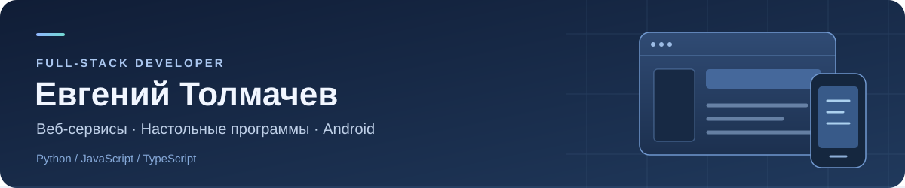

**Python / JavaScript / TypeScript · Full-stack разработка**

Создаю веб-сервисы, настольные программы и Android-приложения. Разрабатываю интерфейсы и API, организую хранение данных, подключаю внешние сервисы и автоматизирую рабочие процессы. В портфолио собраны самостоятельные проекты: от Python-инструментов и Telegram-ботов до приложений с серверной частью и собственным интерфейсом.

**[Портфолио](https://evgeny-dev.pro/) · [Все проекты](https://evgeny-dev.pro/projects.html) · [Написать мне](mailto:webworktop@gmail.com)**

## Избранные приложения

<table>
<tr>
<td width="50%" valign="top">
<h3><a href="https://github.com/EvgenyET/RektFix-portfolio">RektFix</a></h3>

Веб-сервис для исследования создателей токенов.

Поиск, профили и история запусков. Сборщик данных работает отдельно от сайта, сохраняет прогресс и синхронизирует результаты с серверной базой.

<code>TypeScript</code> <code>React</code> <code>Next.js</code> <code>Cloudflare D1</code>

<a href="https://github.com/EvgenyET/RektFix-portfolio">Разбор проекта</a> · <a href="https://evgeny-dev.pro/project.html?id=RektFix">Демонстрация</a>

</td>
<td width="50%" valign="top">
<h3><a href="https://github.com/EvgenyET/TextPad-portfolio">TextPad</a></h3>

Настольный редактор заметок и документов.

Рабочие пространства, вкладки и форматирование. Go-часть отвечает за файлы, восстановление черновиков, резервные копии и экспорт документов в DOCX.

<code>Go</code> <code>Wails</code> <code>JavaScript</code>

<a href="https://github.com/EvgenyET/TextPad-portfolio">Разбор проекта</a> · <a href="https://evgeny-dev.pro/project.html?id=TextPad">Демонстрация</a>

</td>
</tr>
<tr>
<td width="50%" valign="top">
<h3><a href="https://github.com/EvgenyET/VoxHit-portfolio">VoxHit</a></h3>

Android-студия синтеза и клонирования голоса.

Мобильный клиент связан с Python API и очередью генерации. Длительные задачи выполняют отдельные обработчики, а приложение показывает их состояние и готовое аудио.

<code>Kotlin</code> <code>Jetpack Compose</code> <code>Python</code> <code>FastAPI</code>

<a href="https://github.com/EvgenyET/VoxHit-portfolio">Разбор проекта</a> · <a href="https://evgeny-dev.pro/project.html?id=VoxHit">Демонстрация</a>

</td>
<td width="50%" valign="top">
<h3><a href="https://github.com/EvgenyET/GlassNoir-portfolio">GlassNoir</a></h3>

Android-приложение с авторским набором иконок.

Каталог, категории, поиск и применение в совместимых лаунчерах. Инструменты сборки связывают графические ресурсы, метаданные и соответствия приложениям.

<code>Kotlin</code> <code>Jetpack Compose</code> <code>Android</code>

<a href="https://github.com/EvgenyET/GlassNoir-portfolio">Разбор проекта</a> · <a href="https://evgeny-dev.pro/project.html?id=GlassNoir">Демонстрация</a>

</td>
</tr>
</table>

У коммерческих приложений опубликованы описания, скриншоты и техническое устройство. Исходники сохраняются в закрытой разработке. В разделах «Мой вклад» описаны выполненные мной задачи.

## Открытый код: с чего начать

| Проект | Что можно оценить в коде |
| --- | --- |
| [**RektRadar**](https://github.com/EvgenyET/RektRadar) - мониторинг событий Bybit | Асинхронный поток WebSocket, агрегация статистики, повторные подключения и отчёты в Telegram. В репозитории есть тесты обработки событий и отправки. |
| [**Тестирование стратегии EMA**](https://github.com/EvgenyET/bitcoin_chart_project) | Django API, расчёты на pandas и интерактивный Canvas-график. Есть инструкции для локального запуска, демонстрационные данные и тесты. |
| [**PumpFun TraderBot**](https://github.com/EvgenyET/PumpFun_TraderBot) | Связка Flask API и настольной панели PyQt5: мониторинг данных, симулятор сделок и управление через интерфейс. |
| [**ClickFarm**](https://github.com/EvgenyET/ClickFarm) | Автоматизация публикаций через API, локальная база SQLite и сбор статистики. |

## Технологии в моих проектах

| Направление | Основные инструменты |
| --- | --- |
| Веб-интерфейсы | TypeScript, JavaScript, React, Next.js, HTML, CSS |
| API и серверная логика | Python, FastAPI, Django, Django REST Framework, Flask, Node.js, Express, Fastify |
| Настольные приложения | Go / Wails, Electron, PyQt5, C# / WebView2 |
| Android | Kotlin, Jetpack Compose |
| Данные и интеграции | PostgreSQL, MySQL, SQLite, MongoDB, pandas, WebSocket, Telegram Bot API / Mini Apps |
| Сборка и развёртывание | Git, Docker, Nginx, Linux, Webpack |

## Ещё несколько направлений

- [**StarMap**](https://github.com/EvgenyET/StarMap_web_app-portfolio) - интерактивная 3D-карта на Three.js, личный кабинет и коллекция звёзд.
- [**ScalperBot**](https://github.com/EvgenyET/ScalperBot-portfolio) - настольный терминал с потоковыми рыночными данными, анализом ликвидности и симуляцией торговли.
- [**Calorica**](https://github.com/EvgenyET/Calorica-portfolio) - дневник питания и активности для Windows с графиками, импортом истории и локальным хранением.

[Посмотреть весь каталог со скриншотами и видео](https://evgeny-dev.pro/projects.html)

## Образование и развитие

Профессиональная переподготовка в **Нетологии**, программа Python-разработки, **2021-2023**. Получил диплом о профессиональной переподготовке. [Образование и документы](https://evgeny-dev.pro/education.html) · [Дипломный проект](https://github.com/EvgenyET/final_diplom_python).

Проекты в портфолио показывают развитие практики с 2022 года. Репозитории, подготовленные для портфолио, публиковались отдельно от рабочих проектов, поэтому дата первого коммита здесь может отличаться от даты начала разработки.

---

**Открыт к предложениям о работе и сотрудничестве.**  
[webworktop@gmail.com](mailto:webworktop@gmail.com) · [evgeny-dev.pro](https://evgeny-dev.pro/)
